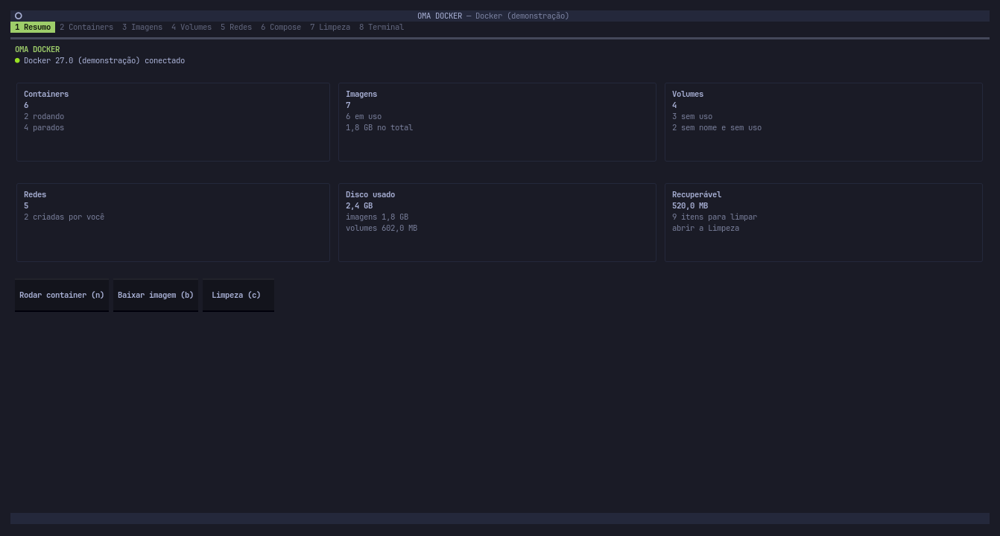
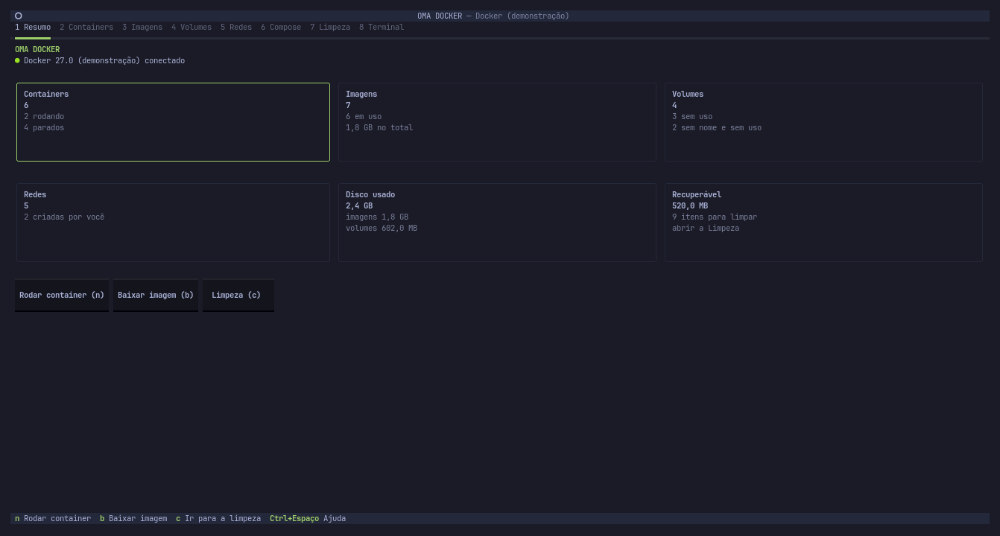
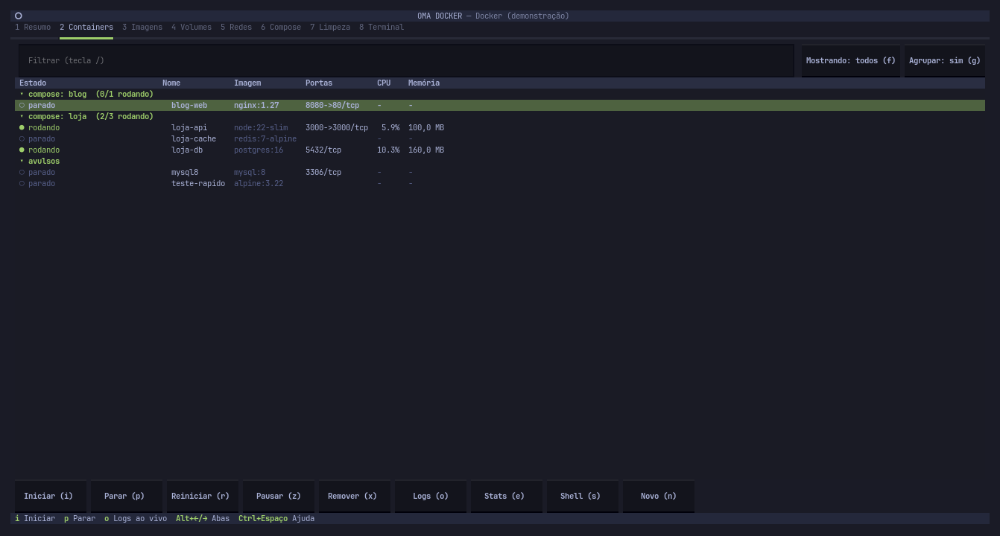
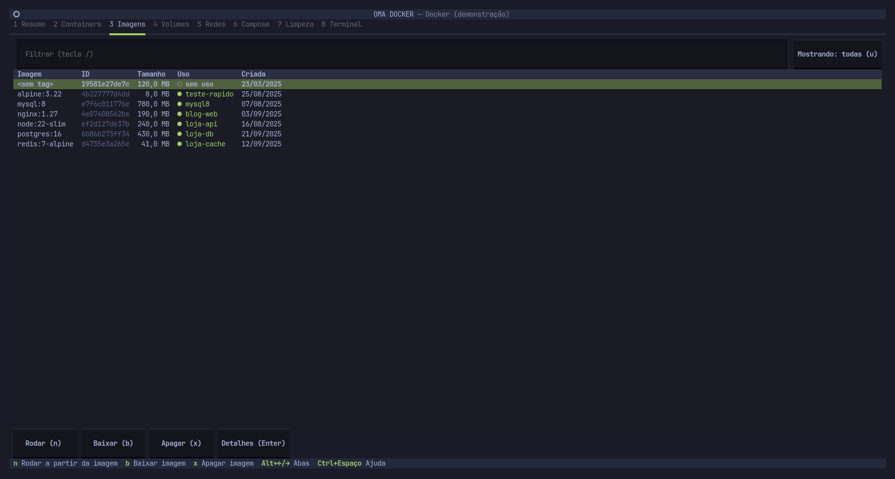
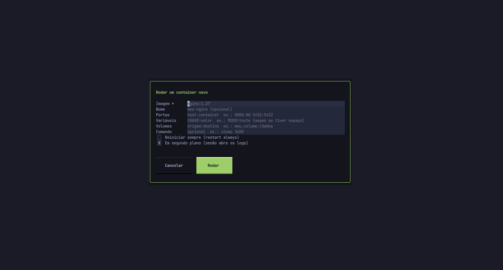
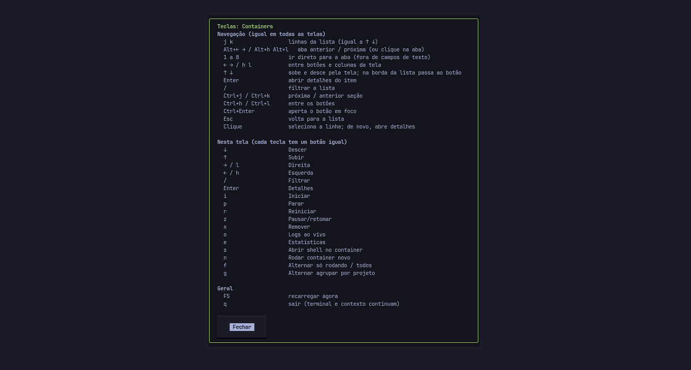

# oma-docker

TUI em Python (Textual) para gerenciar o Docker: containers, imagens, volumes,
redes, projetos compose e limpeza, uma tela por vez, com mouse e teclado, em
português do Brasil e nas cores do tema ativo do Omarchy.

Versão 0.1.1.

## Capturas de tela



Abertura: aparece na primeira vez de cada boot e passa com qualquer tecla, clique ou depois de 1,5 s.



Resumo: contagens, uso de disco e quanto dá para recuperar. Cada cartão é clicável.



Containers: agrupados por projeto compose, com estado em cor e ícone, portas, CPU e memória.



Imagens: tamanho, se estão em uso e por quem.



Rodar um container novo a partir de uma imagem, por formulário.



Ctrl+Espaço (ou F1) abre as teclas da tela atual. As capturas usam o modo `--demo`, com dados de exemplo.

## Recursos

- 8 telas: Resumo, Containers, Imagens, Volumes, Redes, Compose, Limpeza e Terminal.
- Containers: iniciar, parar, reiniciar, pausar e retomar, remover, logs ao vivo,
  estatísticas, detalhes (portas, volumes, variáveis, redes, comando), shell dentro
  do container e rodar um container novo (nome, imagem, portas, variáveis, volumes,
  comando, reiniciar sempre, segundo plano).
- Imagens: baixar com progresso, apagar, rodar a partir dela.
- Volumes e redes: criar e apagar. Volumes sem nome e sem uso aparecem marcados.
- Compose: subir, parar e reiniciar o projeto inteiro, editar o arquivo no nvim, abrir um terminal na pasta do projeto.
- Limpeza: lista o que dá para apagar com tamanho, você marca, vê o resumo e confirma.
- Toda ação destrutiva pede confirmação mostrando o que será apagado e o tamanho. Volume com dados leva um aviso reforçado.
- Erros do Docker em linguagem clara (por exemplo, "A porta 8080 já está em uso").
- Atualização automática leve (a cada 2 s, só na tela visível), sem travar a interface.
- Tudo funciona por mouse e por teclado: toda tecla tem botão equivalente, e nada fica só no teclado.

## Instalar

Dependências: `python` (3.13 ou mais novo), `python-textual`, `python-docker`, `tmux`. O usuário precisa estar no grupo `docker`.
Para projetos compose, `docker-compose` (o app chama `docker compose`).

```bash
cd packaging
./empacotar.sh              # gera o pacote em packaging/
sudo pacman -U oma-docker-0.1.1-1-any.pkg.tar.zst
oma-docker
```

Para ver o app sem Docker, com dados de exemplo: `oma-docker --demo`.

## Teclas

Cada tecla tem um botão clicável na mesma tela. O rodapé mostra no máximo 5 teclas, as da zona em foco. Ctrl+Espaço lista todas.

| Tecla | Ação | Equivalente com o mouse |
|---|---|---|
| `Alt+←` `Alt+→` ou `Alt+h` `Alt+l` | aba anterior e próxima (valem até com o foco num campo de texto) | clicar na aba |
| `1` a `8` | ir direto para a aba (fora de campos de texto) | clicar na aba |
| `↑` `↓` ou `j` `k` | linhas da lista; na borda da lista passa para o filtro ou para os botões | clicar na linha |
| `←` `→` ou `h` `l` | entre botões, cartões e colunas da tela | clicar no botão |
| `Enter` | detalhes do item | clicar de novo na linha |
| `/` | filtrar | clicar no campo Filtrar |
| `Ctrl+j` `Ctrl+k` | próxima e anterior seção | clicar |
| `Ctrl+h` `Ctrl+l` ou `Ctrl+←` `Ctrl+→` | entre botões | clicar no botão |
| `Ctrl+Enter` | aperta o botão em foco | clicar |
| `Esc` | voltar para a lista, fechar diálogo | botão Cancelar ou Fechar |
| `Ctrl+Espaço` ou `F1` | ajuda da tela | (aperte a tecla) |
| `F5` | recarregar agora | |
| `q` | sair | |

As setas sem Alt não trocam de aba: andam pela página, e dá para alcançar tudo da tela só com elas, sem Tab.

Containers: `i` iniciar, `p` parar, `r` reiniciar, `z` pausar ou retomar, `x` remover, `o` logs, `e` estatísticas, `s` shell, `n` rodar novo, `f` só rodando ou todos, `g` agrupar.
Imagens: `n` rodar, `b` baixar, `x` apagar, `u` só sem uso. Volumes: `c` criar, `x` apagar, `u` só sem uso. Redes: `c` criar, `x` apagar.
Compose: `u` subir, `p` parar, `r` reiniciar, `e` editar, `t` terminal, `c` ver containers.
Limpeza: `Espaço` marcar, `a` marcar tudo, `d` desmarcar, `x` apagar os marcados.
Terminal: `t` abrir, `n` nova janela, `e` editar arquivo, `x` encerrar.

## Abertura e contexto

- Na primeira abertura de cada boot aparece a tela OMA DOCKER. Ela passa com qualquer tecla, clique ou depois de 1,5 s. Nas aberturas seguintes do mesmo boot ela não aparece.
- O estado da interface (tela atual, linha selecionada, filtros, projeto selecionado, log que estava sendo seguido, rascunho do formulário de rodar, itens marcados na Limpeza) é salvo continuamente em `$XDG_RUNTIME_DIR/oma-docker/estado.json`.
- Fechar o app não apaga nada. Reabrir no mesmo boot volta ao mesmo ponto.
- `$XDG_RUNTIME_DIR` é `/run/user/<uid>`, um tmpfs criado no primeiro login e apagado pelo systemd quando o último login do usuário termina, e no desligamento ou reinício. Por isso o contexto some sozinho nesses casos.
- Variáveis de ambiente do formulário cujo nome parece segredo (senha, token, chave, secret) não são gravadas no rascunho.
- Arquivo corrompido ou de versão antiga é ignorado, e o app começa do zero.

## Terminal e contexto

O terminal usa um servidor tmux dedicado do app, separado do tmux pessoal e sem tocar em `~/.tmux.conf`:

- Socket: `$XDG_RUNTIME_DIR/oma-docker/tmux.sock`. Configuração própria em `src/oma_docker/data/tmux.conf` (mouse ligado, cores verdadeiras, prefixo `Ctrl+q`, `Alt+q` volta ao app).
- Abrir o terminal suspende o app, o shell ou o nvim ocupa o terminal inteiro, e `Alt+q` (ou fechar com `exit`) devolve ao app no mesmo lugar.
- Fechar o app, ou a janela do terminal, não mata a sessão. O shell e o nvim continuam vivos, e reabrir o app no mesmo boot reanexa na mesma sessão e janela.
- "Editar compose" e "Editar arquivo" abrem o nvim numa janela do tmux. Se a janela já existe, ela é reaproveitada, com buffers e cursor como estavam.
- "Shell" num container abre uma janela com `docker exec -it`.
- A sessão some no reinício ou desligamento (o socket fica em tmpfs).
- Encerrar de propósito: botão "Encerrar terminal" na tela Terminal, ou tecla `x` nela (pede confirmação e avisa se há nvim aberto). Fora do app: `tmux -S "$XDG_RUNTIME_DIR/oma-docker/tmux.sock" ls` lista, e `... kill-server` encerra.
- Sem o tmux instalado, o app avisa e abre o shell sem persistência.

## Desenvolvimento e testes

```bash
uv sync --extra dev
uv run pytest                 # unitários e de interface, com cliente Docker falso
uv run pytest -m docker       # contra o Docker real (leitura, e recursos com rótulo oma-docker-test)
uv run oma-docker --demo      # dados de exemplo
```

Os testes de interface usam o piloto do Textual (teclado e clique) contra um cliente falso em memória. Os testes `-m docker` só listam e criam
recursos com o rótulo `oma-docker-test=1` a partir da imagem `alpine:3.22` já existente (não baixam imagens), e removem só o que tem o rótulo.
As decisões técnicas estão em [DECISOES.md](DECISOES.md).

## Licença

MIT, ver [LICENSE](LICENSE).
